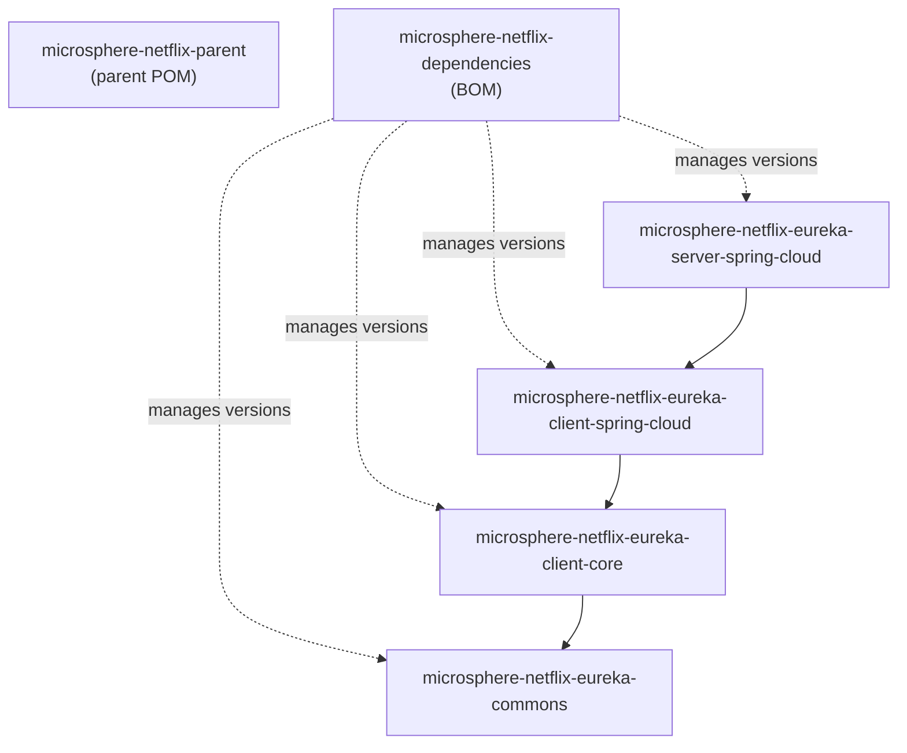

# Developer Guide — `release-1.x` Branch (1.x line)

Architecture, source analysis, design patterns, and flows for the maintenance line. Where the implementation
matches the current line exactly, this guide links to the corresponding
[developer guide](../../current/developer-guide/README.md) section and only documents the deltas.

## Module Dependency Graph

External foundations: `microsphere-java-core`, `microsphere-spring-cloud-commons`,
`spring-cloud-starter-netflix-eureka-client/server`, `eureka-client`, `jakarta.servlet-api`,
`tomcat-tribes`, `tomcat-catalina-ha`.

## System Architecture

The runtime architecture is the same two-plane design as the current line — Spring-side event observation
plus a Tomcat Tribes data plane carrying `ServletContext`-attribute-triggered `ReplicatedMap` messages.
See the [current developer guide README](../../current/developer-guide/README.md#system-architecture)
diagram, which applies unchanged; only the Java packages of the server module differ
(`io.microsphere.netflix.eureka.spring.cloud.*`).

## Documents

| Document | Focus |
|----------|-------|
| [parent-and-dependencies.md](parent-and-dependencies.md) | Build model deltas on the 1.x branch |
| [eureka-commons.md](eureka-commons.md) | Constants (identical to current) |
| [eureka-client-core.md](eureka-client-core.md) | Composite handler (identical to current) |
| [eureka-client-spring-cloud.md](eureka-client-spring-cloud.md) | Null-guard delta and shared design analysis |
| [eureka-server-spring-cloud.md](eureka-server-spring-cloud.md) | Listener lifecycle and codec-resolution deltas, flows |

## Testing Notes (branch specifics)

- The server module tests live under `io.microsphere.netflix.eureka.spring.cloud.tomcat` and include:
  - `TomcatEurekaServerReplicationAutoConfigurationTest` — two in-process servers converge via multicast;
  - a WAR-deployment skeleton in `src/test/webapp` (`web.xml` marked `<distributable/>`, `context.xml`
    using `ReplicatedContext`).
- `EurekaServerApplication` in `src/test/java` doubles as the documented sample bootstrap (the line has no
  bootstrap module).
- `microsphere-spring-boot-test` and `spring-boot-starter-test` are the test harnesses; JUnit Jupiter 5.

## 中文

[docs/zh/1.x/developer-guide/README.md](../../zh/1.x/developer-guide/README.md)
