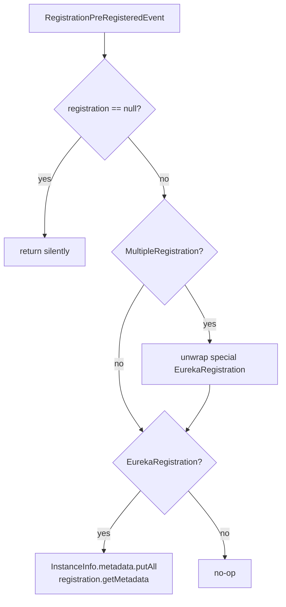

# Eureka Client Spring Cloud — Developer Guide (`1.x`)

Module: `microsphere-netflix-eureka-client-spring-cloud` (branch `release-1.x`) · Package root:
`io.microsphere.netflix.eureka.client.spring.cloud`

## Architecture

The three extension seams (context initializer, bean post-processor, ordered auto-configurations) and the
AOP-based multiple-client aggregation are implemented identically to the current line. Read the
[current developer guide](../../current/developer-guide/eureka-client-spring-cloud.md) for the full
architecture diagram, source analysis, design-patterns table, and sequence flows.

## Branch Deltas

### `EnhancedEurekaClientAutoConfiguration`

The 1.x event handler adds a defensive early return before type dispatch:

```java
Registration registration = event.getRegistration();
if (registration == null)
    return;

if (registration instanceof MultipleRegistration) { ... }
```

Rationale: older Spring Cloud versions could publish `RegistrationPreRegisteredEvent` with a null
registration during partial startup; the guard makes the listener silently skip such events. This matches
the project's null-safety convention of early-return degradation rather than new assertions.

### Everything else

| Class | Status on `release-1.x` |
|-------|--------------------------|
| `MultipleEurekaClientAutoConfiguration` | identical |
| `AbstractDiscoveryClientOptionalArgsBeanPostProcessor` | identical |
| `EurekaClientApplicationContextInitializer` | identical |
| `PropagatingEurekaEventListener` | identical |
| Conditional annotations + constants | identical |
| `META-INF/spring.factories` + `AutoConfiguration.imports` | identical |

## Flow: Metadata Sync with Null Guard



## 中文

[docs/zh/1.x/developer-guide/eureka-client-spring-cloud.md](../../zh/1.x/developer-guide/eureka-client-spring-cloud.md)
