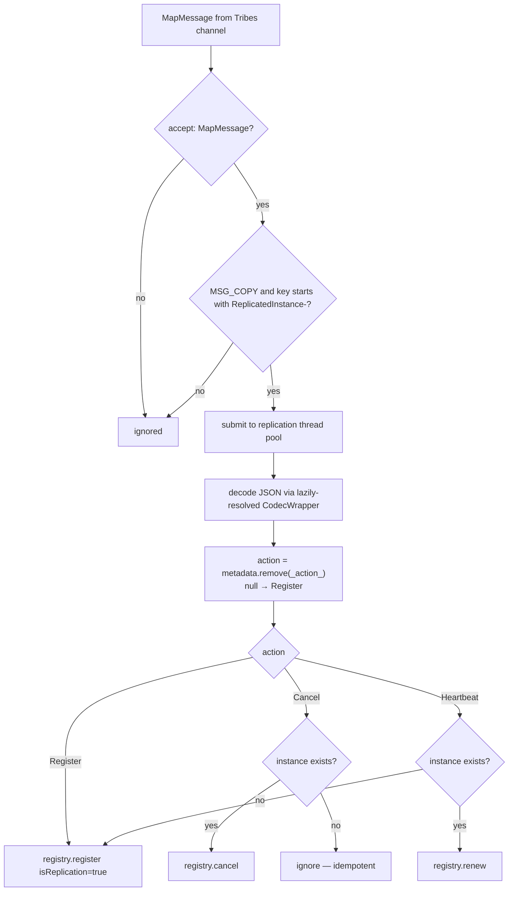

# Eureka Server Spring Cloud — Developer Guide (`1.x`)

Module: `microsphere-netflix-eureka-server-spring-cloud` (branch `release-1.x`) · Package root:
`io.microsphere.netflix.eureka.spring.cloud` (no `.server.` segment)

## Architecture

Two-plane replication design (Spring-event outbound path over `ServletContext` attributes → `ReplicatedMap`
→ Tribes channel; inbound `ChannelListener` replaying actions into `PeerAwareInstanceRegistry`) is the same
as the current line — see the
[current developer guide](../../current/developer-guide/eureka-server-spring-cloud.md) for the architecture
diagram, cluster-bootstrap analysis, replication protocol, and the end-to-end sequence diagram, all of
which apply with the package rename.

## `TomcatEurekaServerReplicationAutoConfiguration`

Identical to the current line except the package: same `cluster.xml` digester flow with Spring property
placeholder resolution, same `TomcatContextCustomizer` installation, same `ReplicatedMap` ownership, same
ordered shutdown (`listener.stop() → replicatedMap.breakdown() → cluster.stop()`).

## Listener Deltas (the interesting part)

### `EurekaServerListener`

| Aspect | `release-1.x` | `release` |
|--------|---------------|-----------|
| Shutdown entry | `contextDestroyed` → `deregister()` | `contextDestroyed` → `destroy()` → `deregister()` |
| `deregistered` field | `private volatile` | package-visible `volatile` (tests toggle it directly) |
| Codec/registry capture | private instance methods `initCodecWrapper` / `initPeerAwareInstanceRegistry` | package-visible **static** `getCodecWrapper` / `getPeerAwareInstanceRegistry`, reused by `ReplicatedInstanceListener` and tests |

Both lines encode the same wire protocol: `metadata[_action_] = Action`, JSON via `getFullJsonCodec()`,
attribute name `ReplicatedInstance-` + instance id, immediate cleanup after the broadcast-triggering
`setAttribute`.

### `ReplicatedInstanceListener`

| Aspect | `release-1.x` | `release` |
|--------|---------------|-----------|
| Codec resolution | lazy per decode: `getCodecWrapper()` reads `eurekaServerContext.getServerCodecs().getFullJsonCodec()` at use time, null-safe if context missing | eager in constructor, shared static helper |
| ServletContext self-registration | none | stores itself under its class name; static `get(ServletContext)` accessor for tooling/tests |
| Periodic sweep | scheduled task body wrapped in `async(...)` (double indirection through the pool) | inline execution on the scheduled thread, body itself re-submitted via `processRegisteredInstancesAsync` |
| Action switch | explicit `case Register`, then `Cancel`, then `Heartbeat` | `default:` covers Register |
| API surface | processing members private | package-visible `process(String)`, `process(InstanceInfo, String)`, `decodeReplicatedInstance`, `getRegistry`, `getEurekaServerContext` for tests |

Replication semantics (MSG_COPY filter, prefix filter, `isReplication = json != null`, heartbeat→register
promotion, cancel-if-exists) are identical.

## Flow: Inbound Replication (1.x variant)

## WAR Deployment Support Artifacts

The branch's `src/test/webapp` demonstrates the external-Tomcat path this line still targets:

- `WEB-INF/web.xml` — `<distributable/>` marks the context cluster-aware for Tribes.
- `META-INF/context.xml` — `<Context className="org.apache.catalina.ha.context.ReplicatedContext">` adds
  Tomcat's native attribute replication alongside the module's `ReplicatedMap`.
- `META-INF/conf/server.xml` — server skeleton for the same test.

These are test fixtures, not shipped resources, but they document the intended deployment shape for 1.x users.

## 中文

[docs/zh/1.x/developer-guide/eureka-server-spring-cloud.md](../../zh/1.x/developer-guide/eureka-server-spring-cloud.md)
