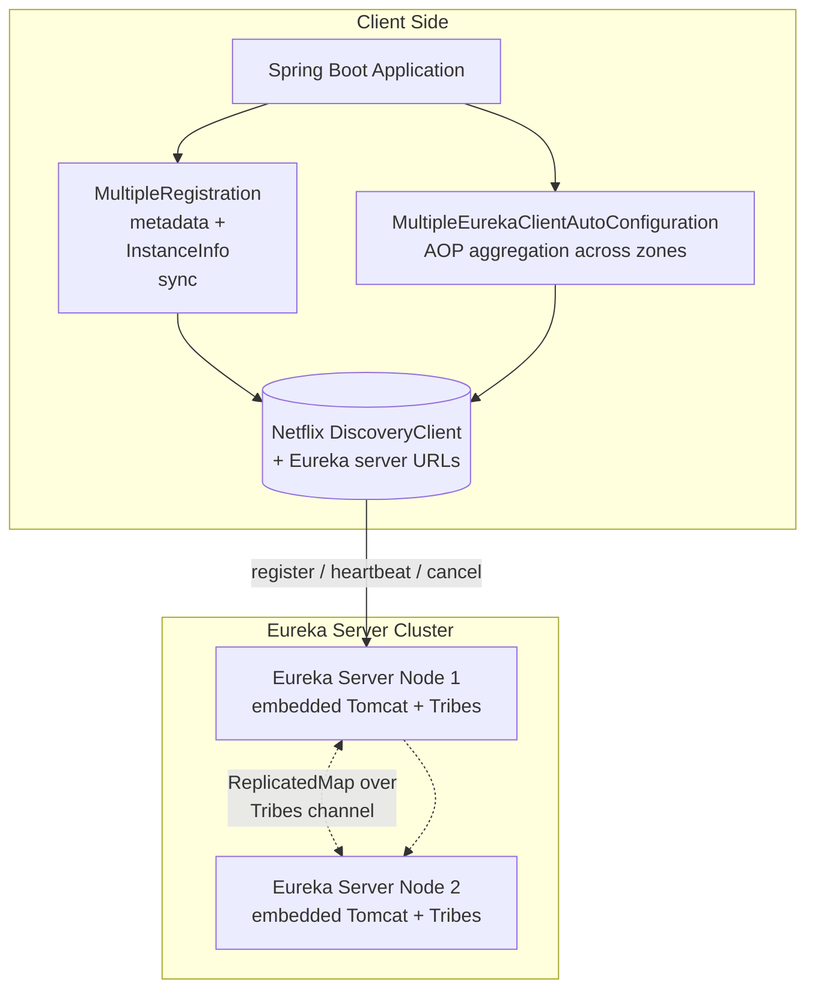
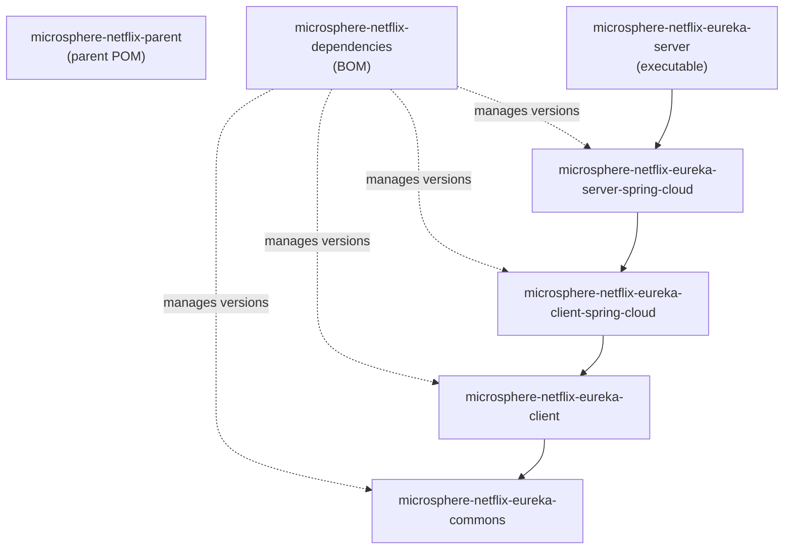
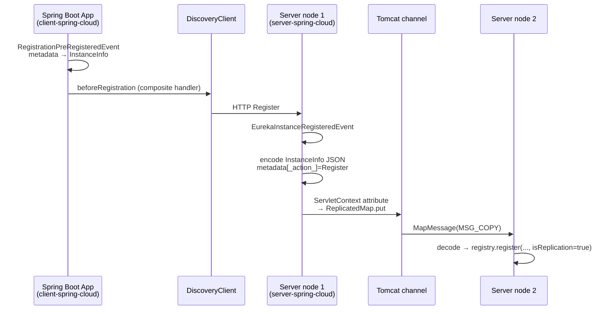

# Developer Guide — `release` Branch (0.2.x)

This guide is for contributors and engineers who need to understand or extend microsphere-netflix.
Each Maven module has a dedicated document covering architecture, source analysis, design patterns,
and mermaid flow diagrams for complex processes.

## System Architecture

## Module Dependency Graph

Build-time (Maven) dependencies between repository modules — arrows point to the dependency:

External foundations: `microsphere-java-core`, `microsphere-spring-cloud-commons`,
`com.netflix.eureka:eureka-client` / `eureka-server` (via Spring Cloud Netflix starters),
`tomcat-tribes` + `tomcat-catalina-ha` (clustering), `jakarta.servlet-api`.

## Cross-Module Runtime Flow: Instance Registration End-to-End

## Module Documents

| Document | Focus |
|----------|-------|
| [parent-and-dependencies.md](parent-and-dependencies.md) | Build model, `${revision}` flattening, BOM strategy |
| [eureka-commons.md](eureka-commons.md) | Constants design, `@ConfigurationProperty` metadata generation |
| [eureka-client.md](eureka-client.md) | Composite + Prioritized source analysis |
| [eureka-client-spring-cloud.md](eureka-client-spring-cloud.md) | Auto-configuration ordering, BeanPostProcessor, AOP aggregation flows |
| [eureka-server-spring-cloud.md](eureka-server-spring-cloud.md) | Tomcat cluster bootstrap, replication protocol, shutdown deregistration flows |
| [eureka-server.md](eureka-server.md) | Bootstrap packaging design |

## Testing Strategy

- Unit tests (`CompositePreRegistrationHandlerTest`, `PropertyConstantsTest`) run without infrastructure.
- Integration tests boot real Spring contexts: `EnhancedEurekaClientAutoConfigurationTest` and
  `MultipleEurekaClientAutoConfigurationTest` target a Eureka server at `127.0.0.1:8761`
  (docker compose file `docker/test-services.yml` provides an image for it).
- `TomcatEurekaServerReplicationAutoConfigurationTest` spins up **two** in-process Eureka servers
  (ports 10000/10001) and asserts cluster convergence by polling the registry.
- `EurekaServerTest` is the shared base class: it boots a servlet web context with
  `EurekaServerMarkerConfiguration`, exposes `registry`, `servletContext`, `instanceInfo` fixtures.

## 中文

[docs/zh/current/developer-guide/README.md](../../zh/current/developer-guide/README.md)
