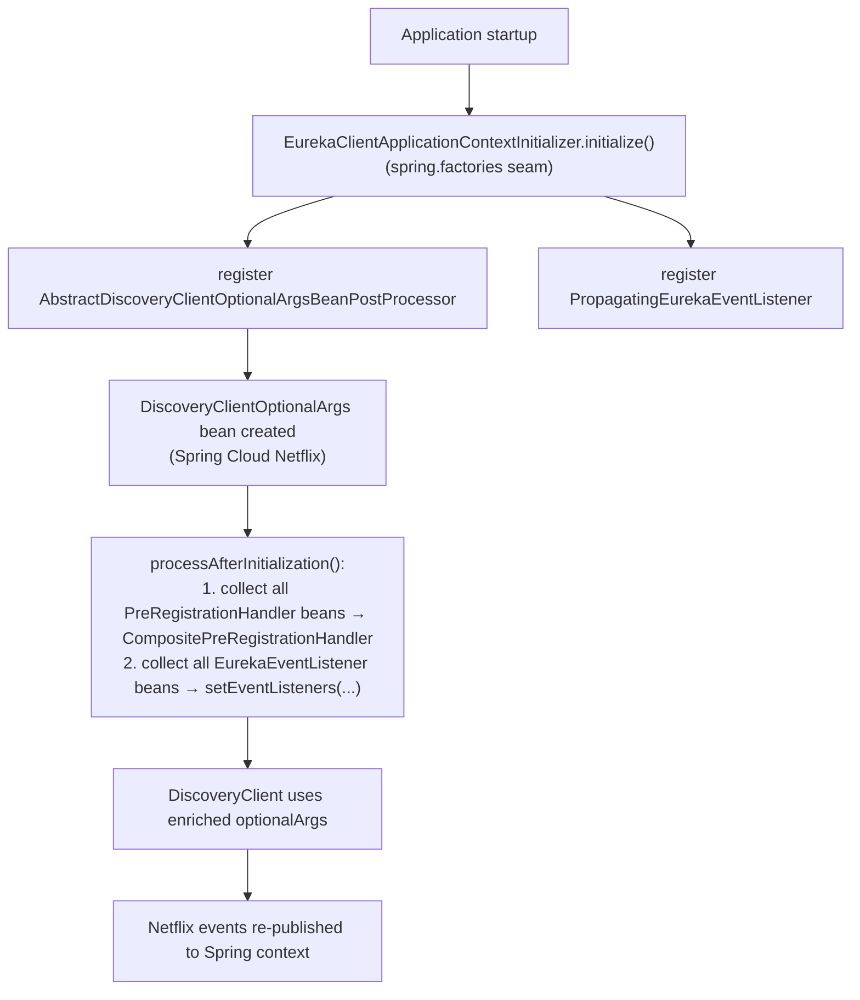
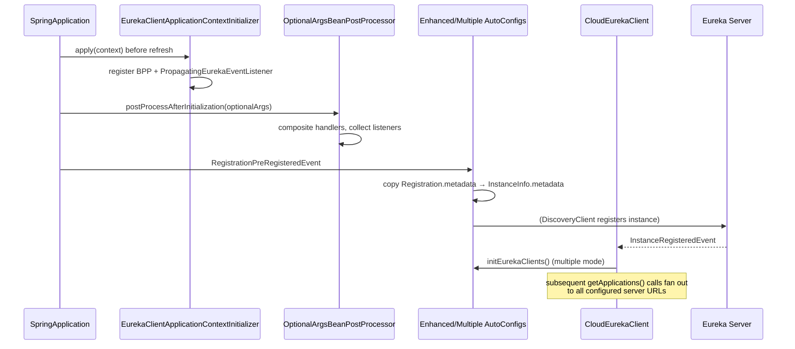

# Eureka Client Spring Cloud — Developer Guide

Module: `microsphere-netflix-eureka-client-spring-cloud` · Package root: `io.microsphere.netflix.eureka.client.spring.cloud`

## Architecture

The module hooks into Spring Cloud Netflix at three extension seams:

1. **Early, before bean refresh** — `EurekaClientApplicationContextInitializer` (registered in
   `META-INF/spring.factories`) installs infrastructure post-processors into the `BeanFactory`.
2. **Bean post-processing** — `AbstractDiscoveryClientOptionalArgsBeanPostProcessor` enriches the Netflix
   optional-args bean with all application handlers/listeners.
3. **Auto-configuration after Spring Cloud** — two configurations declared in
   `META-INF/spring/org.springframework.boot.autoconfigure.AutoConfiguration.imports`, ordered with
   `@AutoConfigureAfter(name = ...)` against `EurekaClientAutoConfiguration` and
   `DiscoveryClientOptionalArgsConfiguration` (name-based to survive classpath absence).



## Source Analysis

### `EnhancedEurekaClientAutoConfiguration`

Single `@EventListener(RegistrationPreRegisteredEvent.class)` method:

```java
Registration registration = event.getRegistration();
if (registration instanceof MultipleRegistration) {
    registration = ((MultipleRegistration) registration).special(EurekaRegistration.class);
}
if (registration instanceof EurekaRegistration) {
    InstanceInfo instanceInfo = eurekaRegistration.getApplicationInfoManager().getInfo();
    instanceInfo.getMetadata().putAll(registration.getMetadata());  // metadata sync
}
```

- Handles `MultipleRegistration` (Microsphere Spring Cloud multi-registry feature) by unwrapping to the
  Eureka-specific `Registration` via `special(Class)`.
- The `1.x` line adds a defensive `registration == null` early-return before the `instanceof` chain.
- `@Configuration(proxyBeanMethods = false)` + `@ConditionalOnDiscoveryEnabled` +
  `@ConditionalOnEurekaClientAvailable` keep the bean cheap and inert when Eureka is off.

### `MultipleEurekaClientAutoConfiguration`

Design: **decorate, don't replace**. The primary Spring-managed `CloudEurekaClient` stays untouched; an
AOP `NameMatchMethodPointcutAdvisor` (class filter `CloudEurekaClient.isAssignableFrom`, methods
`getApplications`, `getInstancesByVipAddress`) intercepts those two read methods and fans the call out to
every managed client.

Client fan-out construction (`initEurekaClients`, lazily triggered by the interceptor or
`InstanceRegisteredEvent`):

```mermaid
flowchart TD
    S[start] --> P["read eureka.client.serviceUrl.<zone> lists"]
    P --> C{serviceUrls.size()}
    C -->|1| ONE[primary client only]
    C -->|n>1| LOOP["for i = 1..n-1"]
    LOOP --> COPY["BeanUtils.copyProperties(original EurekaClientConfigBean)"]
    COPY --> RESET["each zone entry replaced by serviceUrls.get(i)"]
    RESET --> NEW["new DiscoveryClient(applicationInfoManager, copy, transportClientFactories, optionalArgs)"]
    NEW --> LIST[eurekaClients list]
```

Interceptor aggregation logic:

- `doGetApplications` — merges `Applications.getRegisteredApplications()` from all clients into a fresh
  `Applications`.
- `doGetInstancesByVipAddress` — concatenates `List<InstanceInfo>` from all clients.
- Proxy-aware dispatch: `if (isAopProxy(eurekaClient)) invocation.proceed(); else method.invoke(client, args)`
  — the primary client is usually an AOP proxy itself (proceed targets it), while extra clients are raw
  `DiscoveryClient` instances invoked reflectively.

Caching note: `initEurekaClients()` memoizes once (`eurekaClients == null` guard); later property changes
are not picked up until restart.

### Event and bean plumbing

| Class | Role | Notable detail |
|-------|------|----------------|
| `PropagatingEurekaEventListener` | `EurekaEventListener` + `ApplicationEventPublisherAware` | Bridges Netflix-internal events (`CacheRefreshedEvent`, `StatusChange`) into Spring `@EventListener`-compatible publication |
| `AbstractDiscoveryClientOptionalArgsBeanPostProcessor` | extends `GenericBeanPostProcessorAdapter<AbstractDiscoveryClientOptionalArgs>` | `getSortedBeans` applies Spring `Ordered`/`@Order` before compositing handlers; `newLinkedHashSet` preserves listener order |
| `EurekaClientApplicationContextInitializer` | extends `ConfigurableApplicationContextInitializer` | Registers definitions with `BeanRegistrar.registerBeanDefinition` — infrastructure role, no annotations needed on user side |
| `ConditionalOnEurekaClientEnabled` | meta-annotation | Double property gate: `eureka.client.enabled` (Spring) **and** `microsphere.eureka.client.enabled`, both `matchIfMissing = true` |
| `ConditionalOnEurekaClientAvailable` | meta-annotation | `@ConditionalOnClass(name = {...})` on `EurekaClientConstants` names + `@ConditionalOnEurekaClientEnabled` — name-based class test avoids NoClassDefFoundError at metadata parse time |

## Design Patterns

| Pattern | Where | Why |
|---------|-------|-----|
| Adapter / Bridge | `PropagatingEurekaEventListener` | Converts between two event systems (Netflix callback → Spring publish) |
| Composite + Strategy | BPP building `CompositePreRegistrationHandler` | Netflix API supports one handler; Spring apps declare many beans |
| Decorator via dynamic proxy | `eurekaClientAdvisor` | Adds cross-zone aggregation without subclassing `CloudEurekaClient` |
| Template Method | `GenericBeanPostProcessorAdapter.processAfterInitialization`, `ConfigurableApplicationContextInitializer.initialize` | Microsphere Spring commons provide the lifecycle skeleton |
| Lazy Initialization | `initEurekaClients()` | Extra clients are costly (each spawns refresh threads) |
| Marker / meta-annotation | `ConditionalOn*` | Composable condition semantics |

## Flow: Full Client Registration Sequence



## Testing Notes

- `EnhancedEurekaClientAutoConfigurationTest` exercises three paths: direct `EurekaRegistration` event,
  `MultipleRegistration`-wrapped event, and live metadata mutation + `PreRegistrationHandler` invocation.
- `MultipleEurekaClientAutoConfigurationTest` sets `defaultZone` to two URLs (both pointing at the test
  server on 8761) and asserts `getEurekaClients().size() == 2`.
- Both require a reachable Eureka server; CI supplies one via `docker/test-services.yml`.

## 中文

[docs/zh/current/developer-guide/eureka-client-spring-cloud.md](../../zh/current/developer-guide/eureka-client-spring-cloud.md)
