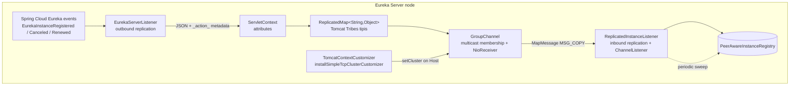
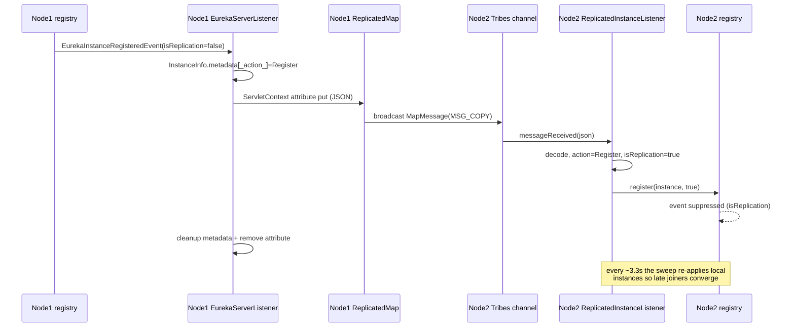

# Eureka Server Spring Cloud — Developer Guide

Module: `microsphere-netflix-eureka-server-spring-cloud` · Package root: `io.microsphere.netflix.eureka.server.spring.cloud`

This is the most complex module: it implements Eureka instance registry replication over an Apache Tomcat
Tribes cluster, using only Servlet/Tomcat extension points — no modification of Netflix Eureka server code.

## Architecture



Outbound path: Spring Cloud Netflix publishes application events when the **local** registry changes;
`EurekaServerListener` serializes the `InstanceInfo` and stores it as a `ServletContext` attribute. The
auto-configuration's inner `Listener` (a `ServletContextAttributeListener`) forwards every serializable
attribute into the Tribes-backed `ReplicatedMap`, which broadcasts `MapMessage(MSG_COPY)` to the cluster.

Inbound path: `ReplicatedInstanceListener`, registered both as a Tribes `ChannelListener` and a Servlet
context listener, decodes the JSON and replays the action against the local `PeerAwareInstanceRegistry` with
`isReplication = true`, which stops Spring Cloud from re-emitting a replication event (no ping-pong loops).

## Source Analysis

### `TomcatEurekaServerReplicationAutoConfiguration`

| Concern | Implementation |
|---------|----------------|
| Activation | `@ConditionalOnClass` (Tomcat startup, `SimpleTcpCluster`, `ClusterRuleSet`) + `@ConditionalOnWebApplication(SERVLET)`; ordered after Boot's servlet-web-server autoconfigurations **and** `EurekaServerAutoConfiguration` (name-based, covering Spring Boot 2.0–4.0 class-name shifts) |
| Cluster bootstrap | `TomcatContextCustomizer` bean: on context customization, `buildCluster()` parses `classpath:/META-INF/conf/cluster.xml` with a Tomcat `Digester` + `ClusterRuleSet`, then `host.setCluster(cluster)` |
| Property injection into XML | the XML is read as a string, passed through Spring's `EmbeddedValueResolver` (`${microsphere.tomcat.cluster.*:default}` placeholders), then re-parsed |
| Digester hardening | `setFakeAttributes` ignores `className`, Eclipse `source`, `portOffset` — attributes Tomcat sets internally that the rule set would reject |
| Map ownership | implements `AbstractReplicatedMap.MapOwner`; `objectMadePrimary` intentionally empty; `ReplicatedMap` created per web context with configured `replicationTimeout` and channel send options |
| Listener wiring | `initReplicatedInstanceListener` adds the listener to the Tribes `Channel`; inner `Listener` implements `ServletContextInitializer` (registers both servlet listeners) and `ServletContextAttributeListener` (attribute → `replicatedMap.put/remove`) |
| Shutdown | `DisposableBean.destroy()` → stop listener executor, `replicatedMap.breakdown()`, `cluster.stop()` — ordered so in-flight messages drain first |

### `EurekaServerListener` (outbound)

- Constructor captures `CodecWrapper` (`serverCodecs.getFullJsonCodec()`), the registry, and prefix/action-key
  configuration from `EurekaServerProperties`.
- Three `@EventListener` methods mirror registry actions; each starts with
  `if (event.isReplication()) return;` — replication-sourced events are never re-broadcast.
- `doReplicateInstance(instance, action)`:

```java
metadata.put(actionKey, action.name());        // tag intent into the payload itself
String json = codecWrapper.encode(instance);
servletContext.setAttribute(prefix + instance.getId(), json); // triggers ReplicatedMap broadcast
metadata.remove(actionKey);                    // local registry stays clean
servletContext.removeAttribute(name);
```

The attribute name **and** the transient metadata key are the replication protocol. No new wire format was
invented — Tribes ships what `ReplicatedMap` already ships.

- Graceful shutdown: `contextDestroyed`/`destroy` call `deregister()` → broadcast `Cancel` for the server's
  own `InstanceInfo`, then `sleep(deregistrationDelay)` so the message leaves before the JVM exits. A
  `volatile boolean deregistered` guard makes it idempotent.

### `ReplicatedInstanceListener` (inbound)

Implements `ServletContextListener` + `ChannelListener`:

| Callback | Behavior |
|----------|----------|
| `accept(msg, sender)` | Only `AbstractReplicatedMap.MapMessage` instances |
| `messageReceived` | Filters `MSG_COPY` type, key prefix `ReplicatedInstance-`, then decodes and applies **asynchronously** on the replication thread pool (`ScheduledThreadPoolExecutor`, daemon threads, configurable size/prefix) |
| `contextInitialized` | Prestarts core threads, stores itself in `ServletContext` under its class name (static accessor `get(servletContext)` for tests/tools), schedules the periodic sweep |
| Periodic sweep | every `PeerEurekaStatusRefreshTimeIntervalMs / 3` (≈3.3 s by default), re-processes **all** locally registered instances with `json = null` — converges state for members that joined after a broadcast was lost |

Action dispatch in `process(replicatedInstance, json)`:

```java
Action action = getAction(replicatedInstance);   // metadata.remove(actionKey), default Register
switch (action) {
    case Heartbeat -> renew(...);    // renew if present, else register (self-healing)
    case Cancel    -> cancel(...);   // skip silently if unknown
    default        -> register(...);
}
```

`isReplication` is derived from `json != null`: channel-originated updates are marked replication so the
Spring Cloud event emission loop is cut; sweep-originated replays pass `isReplication=false`, intentionally
re-broadcasting state to peers during convergence.

### `EurekaServerProperties`

Relaxed-binding tree under `microsphere.eureka.server` (see [user guide](../user-guide/eureka-server-spring-cloud.md)
for the full table). The class also exposes flattened getters (`getActionKey()`, `getThreadsNumber()`, …) that
the listeners consume, keeping the nesting detail inside the properties class.

## Design Patterns

| Pattern | Where | Note |
|---------|-------|------|
| Observer | `@EventListener` methods; Tribes `ChannelListener` | Two independent observer systems bridged by the ServletContext attribute convention |
| Mediator | `ServletContext` attributes ↔ `ReplicatedMap` | Decouples Eureka-land from Tomcat-land |
| Command | action encoded in metadata (`Register`/`Cancel`/`Heartbeat`) | Receiver replays intent, not state diffs |
| Template Method | Digester rule set (`ClusterRuleSet`) drives cluster construction from XML | |
| Daemon Thread Factory | `CustomizableThreadFactory` + `setDaemon(true)` | Replication must not block JVM exit |
| Idempotent Shutdown | `volatile deregistered` flag; `stop()` checks `isShutdown()` | |

## Complex Flow: Full Replication Cycle



## Known Constraints

- Multicast networking (or a modified membership section) is required between nodes.
- `ReplicatedMap` send option `74` (from `cluster.xml`) means async broadcast with ACK to the sender group —
  replication is fast but eventually consistent.
- The instance action lives inside `InstanceInfo.metadata`, so a raw Eureka client could observe a transient
  `_action_` entry between put and remove; the cleanup happens in the same thread immediately after.

## 中文

[docs/zh/current/developer-guide/eureka-server-spring-cloud.md](../../zh/current/developer-guide/eureka-server-spring-cloud.md)
