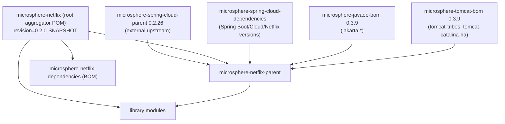

# Parent POM and Dependencies BOM — Developer Guide

Modules: `microsphere-netflix-parent`, `microsphere-netflix-dependencies`

## Build Architecture

## Design Decisions

### CI-friendly `${revision}` versioning

Every POM declares `<version>${revision}</version>`; the root defines `revision`. The flatten-maven-plugin
(configured upstream in `microsphere-spring-cloud-parent`) resolves the placeholder at install/deploy time so
consumers see a concrete version. To bump the whole repository, edit one property.

### Layered dependency management

The parent imports three BOMs in order, so Microsphere Netflix modules never hard-code third-party versions:

| Import | Supplies |
|--------|----------|
| `microsphere-spring-cloud-dependencies` `0.2.26` | Spring Boot, Spring Cloud, Spring Cloud Netflix, `microsphere-spring-*`, `microsphere-java-*` |
| `microsphere-javaee-bom` `0.3.9` | `jakarta.servlet-api` and Java EE API versions |
| `microsphere-tomcat-bom` `0.3.9` | `tomcat-catalina`, `tomcat-tribes`, `tomcat-catalina-ha` versions aligned with the embedded Tomcat used by Spring Boot 3 |

### Intra-repository BOM

`microsphere-netflix-dependencies` manages only the four publishable libraries
(`eureka-commons`, `eureka-client`, `eureka-client-spring-cloud`, `eureka-server-spring-cloud`) with
`${revision}`. The executable `eureka-server` is excluded deliberately — a BOM entry would invite applications
to depend on an application artifact.

### Optional processors

Modules mark `microsphere-annotation-processor`, `spring-boot-configuration-processor`, and
`spring-boot-autoconfigure-processor` as `<optional>true</optional>`: they generate configuration metadata and
`AutoConfiguration` ordering hints at compile time but must not leak to consumers.

## Extending the Build

To add a new module:

1. Register it under `<modules>` in both the root POM and, if publishable, in
   `microsphere-netflix-dependencies`.
2. Inherit `microsphere-netflix-parent` with `<relativePath>../microsphere-netflix-parent/pom.xml</relativePath>`.
3. Depend on third-party libraries **without versions** — versions come from the imported BOMs.

## 中文

[docs/zh/current/developer-guide/parent-and-dependencies.md](../../zh/current/developer-guide/parent-and-dependencies.md)
