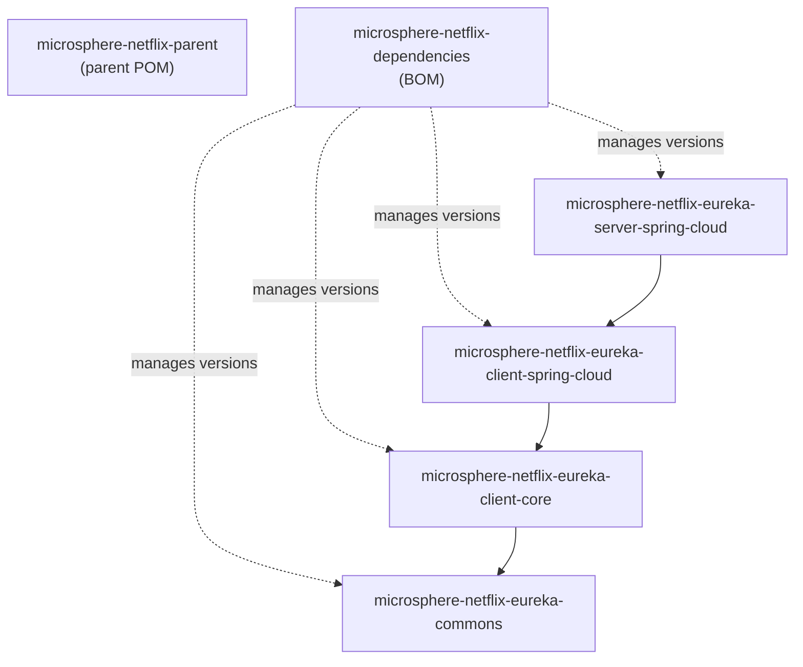

# 开发者指南 —— `release-1.x` 分支（1.x 线）

本维护线（maintenance line）的架构、源码分析、设计模式与流程。当实现与 current 线完全一致时，本指南会链接到
对应的[开发者指南](../../current/developer-guide/README.md)章节，只记录差异点（delta）。

## 模块依赖图

外部基础依赖：`microsphere-java-core`、`microsphere-spring-cloud-commons`、
`spring-cloud-starter-netflix-eureka-client/server`、`eureka-client`、`jakarta.servlet-api`、
`tomcat-tribes`、`tomcat-catalina-ha`。

## 系统架构

运行时架构与 current 线相同，都是双平面（two-plane）设计 —— Spring 侧的事件观察，加上承载
`ServletContext` 属性触发的 `ReplicatedMap` 消息的 Tomcat Tribes 数据平面。
参见[current 开发者指南 README](../../current/developer-guide/README.md#系统架构)中的架构图，
该图原样适用、无需改动；只有 server 模块的 Java 包名不同
（`io.microsphere.netflix.eureka.spring.cloud.*`）。

## 文档

| 文档 | 关注点 |
|------|--------|
| [parent-and-dependencies.md](parent-and-dependencies.md) | 1.x 分支上的构建模型差异 |
| [eureka-commons.md](eureka-commons.md) | 常量（与 current 线一致） |
| [eureka-client-core.md](eureka-client-core.md) | 组合处理器（与 current 线一致） |
| [eureka-client-spring-cloud.md](eureka-client-spring-cloud.md) | 空值保护差异与共享的设计分析 |
| [eureka-server-spring-cloud.md](eureka-server-spring-cloud.md) | 监听器生命周期与编解码器解析差异、流程 |

## 测试说明（分支特有）

- server 模块的测试位于 `io.microsphere.netflix.eureka.spring.cloud.tomcat` 包下，包含：
  - `TomcatEurekaServerReplicationAutoConfigurationTest` —— 两个进程内服务器通过组播（multicast）达成收敛；
  - `src/test/webapp` 中的 WAR 部署骨架（`web.xml` 标记为 `<distributable/>`，`context.xml`
    使用 `ReplicatedContext`）。
- `src/test/java` 中的 `EurekaServerApplication` 同时充当文档里的示例启动类（该分支线没有
  bootstrap 模块）。
- `microsphere-spring-boot-test` 与 `spring-boot-starter-test` 是测试支撑框架；使用 JUnit Jupiter 5。

## English

[docs/1.x/developer-guide/README.md](../../../1.x/developer-guide/README.md)
