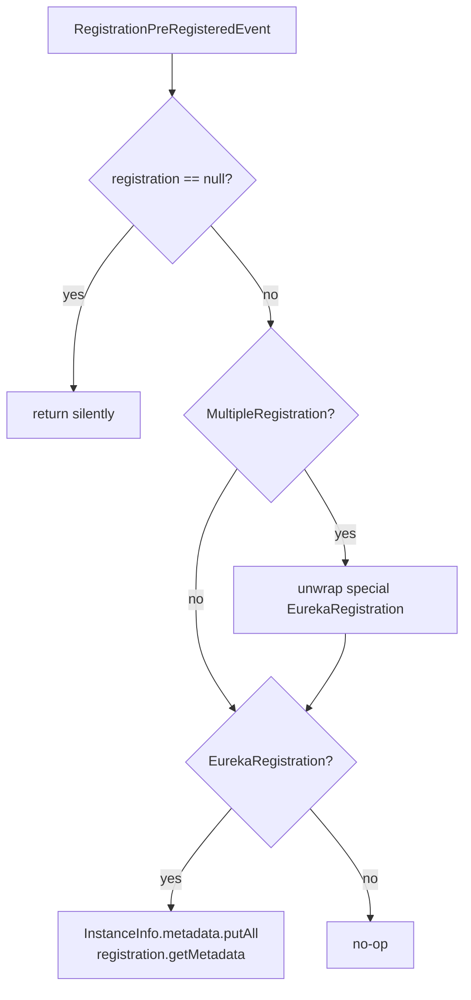

# Eureka Client Spring Cloud —— 开发者指南（`1.x`）

模块：`microsphere-netflix-eureka-client-spring-cloud`（分支 `release-1.x`）· 包根路径：
`io.microsphere.netflix.eureka.client.spring.cloud`

## 架构

三个扩展位点（extension seam）—— 上下文初始化器、Bean 后处理器、有序自动配置 —— 以及基于
AOP 的多客户端聚合，其实现与 current 线完全一致。完整的架构
图、源码分析、设计模式表与时序流程请阅读
[current 开发者指南](../../current/developer-guide/eureka-client-spring-cloud.md)。

## 分支差异

### `EnhancedEurekaClientAutoConfiguration`

1.x 的事件处理器在类型分派之前增加了一个防御性的提前返回（early return）：

```java
Registration registration = event.getRegistration();
if (registration == null)
    return;

if (registration instanceof MultipleRegistration) { ... }
```

提出该改动的原因：较旧版本的 Spring Cloud 在部分启动（partial startup）期间，可能发布 registration 为
null 的 `RegistrationPreRegisteredEvent`；这个保护让监听器静默跳过此类事件。这符合本项目的
null 安全约定 —— 采用提前返回的降级处理，而不是新增断言。

### 其余部分

| 类 | 在 `release-1.x` 上的状态 |
|-------|--------------------------|
| `MultipleEurekaClientAutoConfiguration` | 一致 |
| `AbstractDiscoveryClientOptionalArgsBeanPostProcessor` | 一致 |
| `EurekaClientApplicationContextInitializer` | 一致 |
| `PropagatingEurekaEventListener` | 一致 |
| 条件化注解 + 常量 | 一致 |
| `META-INF/spring.factories` + `AutoConfiguration.imports` | 一致 |

## 流程：带空值保护的元数据同步



## English

[docs/1.x/developer-guide/eureka-client-spring-cloud.md](../../../1.x/developer-guide/eureka-client-spring-cloud.md)
