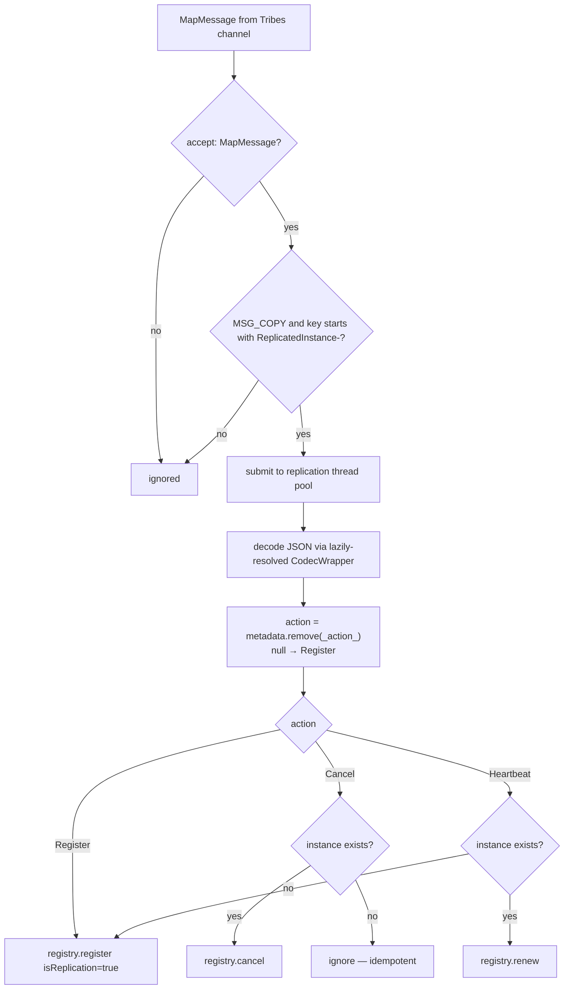

# Eureka Server Spring Cloud —— 开发者指南（`1.x`）

模块：`microsphere-netflix-eureka-server-spring-cloud`（分支 `release-1.x`）· 包根路径：
`io.microsphere.netflix.eureka.spring.cloud`（没有 `.server.` 这一段）

## 架构

双平面复制设计（出向路径为 Spring 事件经 `ServletContext` 属性 → `ReplicatedMap`
→ Tribes 通道；入向 `ChannelListener` 将动作回放到 `PeerAwareInstanceRegistry`）与 current 线
相同 —— 架构
图、集群引导（cluster-bootstrap）分析、复制协议以及端到端时序图请参见
[current 开发者指南](../../current/developer-guide/eureka-server-spring-cloud.md)，这些内容在替换包名后
全部适用。

## `TomcatEurekaServerReplicationAutoConfiguration`

除包名之外与 current 线完全一致：同样的 `cluster.xml` digester 流程并支持 Spring 属性占位符解析，
同样的 `TomcatContextCustomizer` 安装方式，同样的 `ReplicatedMap` 归属管理，同样的有序关闭
（`listener.stop() → replicatedMap.breakdown() → cluster.stop()`）。

## 监听器差异（值得关注的部分）

### `EurekaServerListener`

| 方面 | `release-1.x` | `release` |
|--------|---------------|-----------|
| 关闭入口 | `contextDestroyed` → `deregister()` | `contextDestroyed` → `destroy()` → `deregister()` |
| `deregistered` 字段 | `private volatile` | 包可见的 `volatile`（测试直接改用它） |
| 编解码器/注册表捕获 | 私有的实例方法 `initCodecWrapper` / `initPeerAwareInstanceRegistry` | 包可见的**静态**方法 `getCodecWrapper` / `getPeerAwareInstanceRegistry`，供 `ReplicatedInstanceListener` 与测试复用 |

两条分支线采用相同的线上（wire）协议：`metadata[_action_] = Action`，通过 `getFullJsonCodec()` 输出
JSON，属性名为 `ReplicatedInstance-` + 实例 id，并在触发广播的
`setAttribute` 之后立即清理。

### `ReplicatedInstanceListener`

| 方面 | `release-1.x` | `release` |
|--------|---------------|-----------|
| 编解码器解析 | 每次解码时惰性获取：`getCodecWrapper()` 在使用时才读取 `eurekaServerContext.getServerCodecs().getFullJsonCodec()`，context 缺失时保证 null 安全 | 在构造函数中提前解析，并使用共享的静态工具方法 |
| ServletContext 自我注册 | 无 | 以自身类名为键把自己存入；提供静态 `get(ServletContext)` 访问方法供工具与测试使用 |
| 周期性清扫 | 定时任务体被包裹在 `async(...)` 中（经由线程池产生两层间接调用） | 在定时线程上内联执行，任务体自身通过 `processRegisteredInstancesAsync` 再次提交 |
| Action 分支 | 显式的 `case Register`，随后是 `Cancel`，再是 `Heartbeat` | `default:` 分支覆盖 Register |
| API 暴露面 | 处理相关成员为私有 | 包可见的 `process(String)`、`process(InstanceInfo, String)`、`decodeReplicatedInstance`、`getRegistry`、`getEurekaServerContext`，供测试使用 |

复制语义（MSG_COPY 过滤、前缀过滤、`isReplication = json != null`、心跳提升为注册、
实例存在才执行 cancel）完全一致。

## 流程：入向复制（1.x 变体）

## WAR 部署支持产物

本分支的 `src/test/webapp` 演示了该分支线仍然面向的外部 Tomcat 部署路径：

- `WEB-INF/web.xml` —— 通过 `<distributable/>` 将该 context 标记为可被 Tribes 集群感知。
- `META-INF/context.xml` —— `<Context className="org.apache.catalina.ha.context.ReplicatedContext">`
  在本模块的 `ReplicatedMap` 之外，额外引入 Tomcat 原生的属性复制能力。
- `META-INF/conf/server.xml` —— 同一个测试所使用的 server 骨架。

这些只是测试夹具（test fixture），并非随构件发布的资源，但它们记录了 1.x 用户的预期部署形态。

## English

[docs/1.x/developer-guide/eureka-server-spring-cloud.md](../../../1.x/developer-guide/eureka-server-spring-cloud.md)
