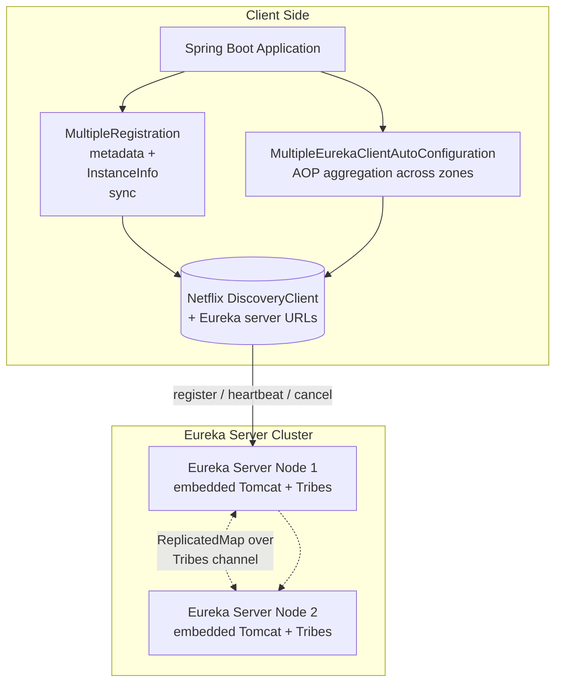
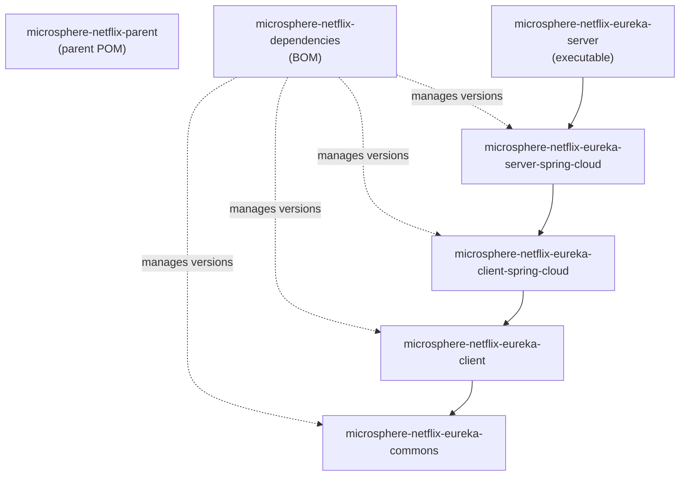
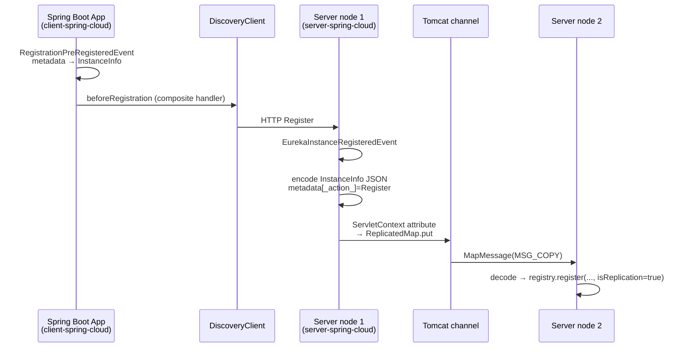

# 开发者指南 —— `release` 分支（0.2.x）

本指南面向需要理解或扩展 microsphere-netflix 的贡献者与工程师。每个 Maven 模块都有一份专门的文档，
涵盖架构、源码分析、设计模式，并用 mermaid 流程图描述复杂流程。

## 系统架构

## 模块依赖图

仓库模块之间的构建期（Maven）依赖关系——箭头指向被依赖的一方：

外部基础依赖：`microsphere-java-core`、`microsphere-spring-cloud-commons`、
`com.netflix.eureka:eureka-client` / `eureka-server`（通过 Spring Cloud Netflix starter 引入）、
`tomcat-tribes` + `tomcat-catalina-ha`（集群能力）、`jakarta.servlet-api`。

## 跨模块运行时流程：实例注册端到端

## 模块文档

| 文档 | 关注点 |
|----------|-------|
| [parent-and-dependencies.md](parent-and-dependencies.md) | 构建模型、`${revision}` 扁平化、BOM 策略 |
| [eureka-commons.md](eureka-commons.md) | 常量设计、`@ConfigurationProperty` 配置元数据生成 |
| [eureka-client.md](eureka-client.md) | 组合（Composite）+ 优先级（Prioritized）源码分析 |
| [eureka-client-spring-cloud.md](eureka-client-spring-cloud.md) | 自动配置排序、BeanPostProcessor、AOP 聚合流程 |
| [eureka-server-spring-cloud.md](eureka-server-spring-cloud.md) | Tomcat 集群引导、复制协议、下线注销流程 |
| [eureka-server.md](eureka-server.md) | 引导打包设计 |

## 测试策略

- 单元测试（`CompositePreRegistrationHandlerTest`、`PropertyConstantsTest`）无需任何外部基础设施即可运行。
- 集成测试会启动真实的 Spring 容器：`EnhancedEurekaClientAutoConfigurationTest` 与
  `MultipleEurekaClientAutoConfigurationTest` 指向 `127.0.0.1:8761` 上的 Eureka 服务端
  （docker compose 文件 `docker/test-services.yml` 提供了对应的镜像）。
- `TomcatEurekaServerReplicationAutoConfigurationTest` 会在进程内启动**两个** Eureka 服务端
  （端口 10000/10001），并通过轮询注册表断言集群最终收敛。
- `EurekaServerTest` 是共享基类：它使用 `EurekaServerMarkerConfiguration` 启动一个 servlet Web 容器，
  并提供 `registry`、`servletContext`、`instanceInfo` 等测试夹具（fixture）。

## English

[docs/current/developer-guide/README.md](../../../current/developer-guide/README.md)
