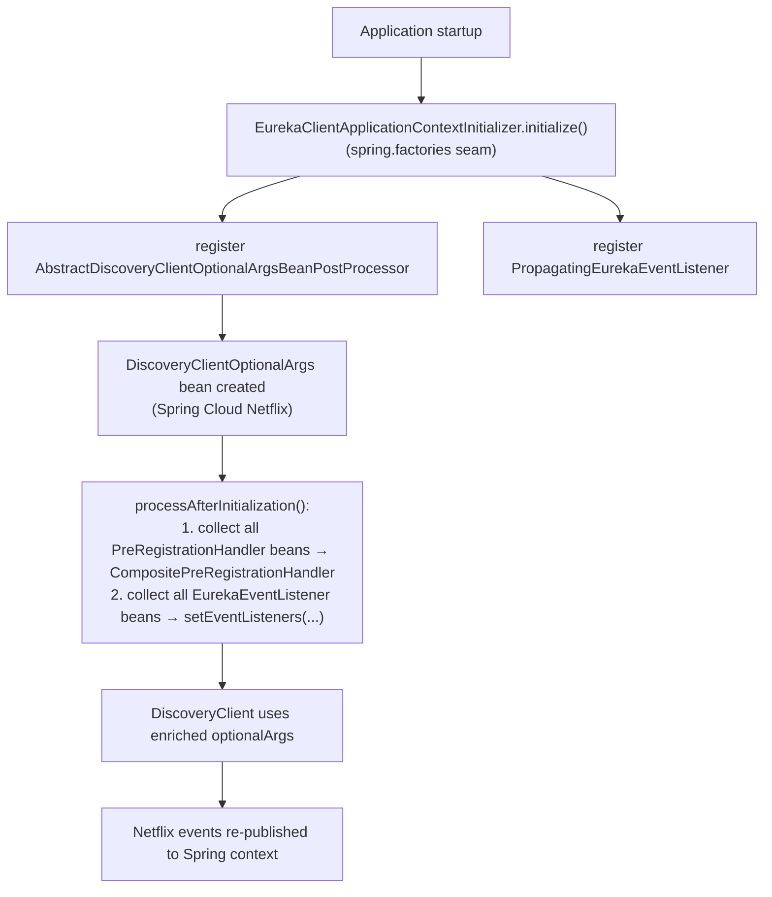
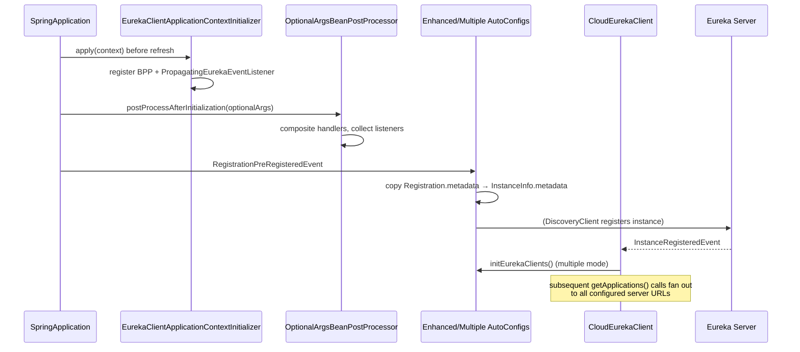

# Eureka Client Spring Cloud —— 开发者指南

模块：`microsphere-netflix-eureka-client-spring-cloud` · 包根路径：`io.microsphere.netflix.eureka.client.spring.cloud`

## 架构

该模块通过三个扩展接缝（seam）挂入 Spring Cloud Netflix：

1. **早期阶段，Bean 刷新之前**——`EurekaClientApplicationContextInitializer`（注册在
   `META-INF/spring.factories` 中）向 `BeanFactory` 安装基础设施级后处理器。
2. **Bean 后置处理**——`AbstractDiscoveryClientOptionalArgsBeanPostProcessor` 用应用提供的全部处理器/监听器
   充实 Netflix 的 optional-args Bean。
3. **在 Spring Cloud 之后自动配置**——两个配置类声明在
   `META-INF/spring/org.springframework.boot.autoconfigure.AutoConfiguration.imports` 中，并通过
   `@AutoConfigureAfter(name = ...)` 相对于 `EurekaClientAutoConfiguration` 和
   `DiscoveryClientOptionalArgsConfiguration` 排序（按名称声明，以便相关类不在类路径上时依然可用）。



## 源码分析

### `EnhancedEurekaClientAutoConfiguration`

只有一个 `@EventListener(RegistrationPreRegisteredEvent.class)` 方法：

```java
Registration registration = event.getRegistration();
if (registration instanceof MultipleRegistration) {
    registration = ((MultipleRegistration) registration).special(EurekaRegistration.class);
}
if (registration instanceof EurekaRegistration) {
    InstanceInfo instanceInfo = eurekaRegistration.getApplicationInfoManager().getInfo();
    instanceInfo.getMetadata().putAll(registration.getMetadata());  // metadata sync
}
```

- 通过 `special(Class)` 解包得到 Eureka 专属的 `Registration`，从而支持
  `MultipleRegistration`（Microsphere Spring Cloud 的多注册中心特性）。
- `1.x` 分支的版本在 `instanceof` 判断链之前额外增加了一个 `registration == null` 的防御性提前返回。
- `@Configuration(proxyBeanMethods = false)` + `@ConditionalOnDiscoveryEnabled` +
  `@ConditionalOnEurekaClientAvailable` 保证在 Eureka 关闭时该 Bean 既轻量又无任何副作用。

### `MultipleEurekaClientAutoConfiguration`

设计思路：**装饰而非替换**。由 Spring 管理的主 `CloudEurekaClient` 保持原样不动；一个 AOP
`NameMatchMethodPointcutAdvisor`（类过滤器为 `CloudEurekaClient.isAssignableFrom`，方法为
`getApplications`、`getInstancesByVipAddress`）拦截这两个读方法，并把调用扇出（fan-out）到每一个受管的客户端。

客户端扇出的构建过程（`initEurekaClients`，由拦截器或 `InstanceRegisteredEvent` 惰性触发）：

```mermaid
flowchart TD
    S[start] --> P["read eureka.client.serviceUrl.<zone> lists"]
    P --> C{serviceUrls.size()}
    C -->|1| ONE[primary client only]
    C -->|n>1| LOOP["for i = 1..n-1"]
    LOOP --> COPY["BeanUtils.copyProperties(original EurekaClientConfigBean)"]
    COPY --> RESET["each zone entry replaced by serviceUrls.get(i)"]
    RESET --> NEW["new DiscoveryClient(applicationInfoManager, copy, transportClientFactories, optionalArgs)"]
    NEW --> LIST[eurekaClients list]
```

拦截器的聚合逻辑：

- `doGetApplications`——将所有客户端的 `Applications.getRegisteredApplications()` 合并进一个全新的
  `Applications`。
- `doGetInstancesByVipAddress`——拼接所有客户端返回的 `List<InstanceInfo>`。
- 感知代理的分派方式：`if (isAopProxy(eurekaClient)) invocation.proceed(); else method.invoke(client, args)`
  ——主客户端自身通常就是一个 AOP 代理（`proceed` 的目标即它），而额外的客户端是原始的
  `DiscoveryClient` 实例，通过反射调用。

缓存说明：`initEurekaClients()` 只记忆化一次（以 `eurekaClients == null` 作为守卫）；后续的属性变更
在重启之前不会被感知。

### 事件与 Bean 装配

| 类 | 职责 | 值得注意的细节 |
|-------|------|----------------|
| `PropagatingEurekaEventListener` | `EurekaEventListener` + `ApplicationEventPublisherAware` | 把 Netflix 内部事件（`CacheRefreshedEvent`、`StatusChange`）桥接成兼容 Spring `@EventListener` 的发布形式 |
| `AbstractDiscoveryClientOptionalArgsBeanPostProcessor` | 继承 `GenericBeanPostProcessorAdapter<AbstractDiscoveryClientOptionalArgs>` | `getSortedBeans` 在组合处理器之前会先按 Spring 的 `Ordered`/`@Order` 排序；`newLinkedHashSet` 保留监听器的顺序 |
| `EurekaClientApplicationContextInitializer` | 继承 `ConfigurableApplicationContextInitializer` | 通过 `BeanRegistrar.registerBeanDefinition` 注册 Bean 定义——属于基础设施职责，用户侧无需任何注解 |
| `ConditionalOnEurekaClientEnabled` | 元注解 | 双重属性开关：`eureka.client.enabled`（Spring）**且** `microsphere.eureka.client.enabled`，两者均为 `matchIfMissing = true` |
| `ConditionalOnEurekaClientAvailable` | 元注解 | 基于 `EurekaClientConstants` 中名称的 `@ConditionalOnClass(name = {...})` + `@ConditionalOnEurekaClientEnabled`——按名称做类存在性判断，避免在解析元数据时抛出 NoClassDefFoundError |

## 设计模式

| 模式 | 所在位置 | 原因 |
|---------|-------|-----|
| 适配器（Adapter）/ 桥接（Bridge） | `PropagatingEurekaEventListener` | 在两套事件体系之间做转换（Netflix 回调 → Spring 事件发布） |
| 组合（Composite）+ 策略（Strategy） | BPP 构建 `CompositePreRegistrationHandler` | Netflix API 只支持一个处理器，而 Spring 应用会声明多个 Bean |
| 通过动态代理实现装饰器（Decorator） | `eurekaClientAdvisor` | 无需继承 `CloudEurekaClient` 即可增加跨可用区聚合能力 |
| 模板方法（Template Method） | `GenericBeanPostProcessorAdapter.processAfterInitialization`、`ConfigurableApplicationContextInitializer.initialize` | 生命周期骨架由 Microsphere Spring commons 提供 |
| 延迟初始化（Lazy Initialization） | `initEurekaClients()` | 额外客户端代价高昂（每个都会启动刷新线程） |
| 标记（Marker）/ 元注解 | `ConditionalOn*` | 可组合的条件语义 |

## 流程：完整的客户端注册时序



## 测试要点

- `EnhancedEurekaClientAutoConfigurationTest` 覆盖三条路径：直接的 `EurekaRegistration` 事件、
  被 `MultipleRegistration` 包装的事件，以及真实的元数据修改 + `PreRegistrationHandler` 调用。
- `MultipleEurekaClientAutoConfigurationTest` 将 `defaultZone` 设为两个 URL（都指向 8761 上的测试服务端），
  并断言 `getEurekaClients().size() == 2`。
- 两者都需要一个可访问的 Eureka 服务端；CI 通过 `docker/test-services.yml` 提供。

## English

[docs/current/developer-guide/eureka-client-spring-cloud.md](../../../current/developer-guide/eureka-client-spring-cloud.md)
