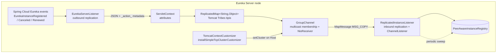
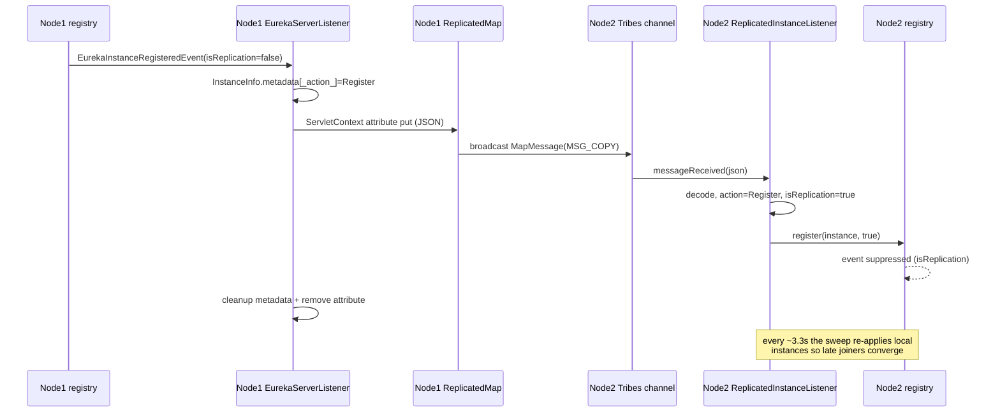

# Eureka Server Spring Cloud —— 开发者指南

模块：`microsphere-netflix-eureka-server-spring-cloud` · 包根路径：`io.microsphere.netflix.eureka.server.spring.cloud`

这是最复杂的模块：它基于 Apache Tomcat Tribes 集群实现了 Eureka 实例注册表的复制，且只使用 Servlet/Tomcat
的扩展点——完全不改动 Netflix Eureka 服务端代码。

## 架构



出站路径：当**本地**注册表发生变化时，Spring Cloud Netflix 会发布应用事件；`EurekaServerListener`
将 `InstanceInfo` 序列化，并作为一个属性存入 `ServletContext`。自动配置的内部类 `Listener`
（一个 `ServletContextAttributeListener`）把每一个可序列化的属性转发给由 Tribes 支撑的 `ReplicatedMap`，
后者向集群广播 `MapMessage(MSG_COPY)`。

入站路径：`ReplicatedInstanceListener` 同时以 Tribes `ChannelListener` 和 Servlet 上下文监听器的身份注册，
它解码 JSON，并在本地 `PeerAwareInstanceRegistry` 上以 `isReplication = true` 重放该动作，
从而阻止 Spring Cloud 再次发出复制事件（避免乒乓循环）。

## 源码分析

### `TomcatEurekaServerReplicationAutoConfiguration`

| 关注点 | 实现方式 |
|---------|----------------|
| 生效条件 | `@ConditionalOnClass`（Tomcat startup、`SimpleTcpCluster`、`ClusterRuleSet`）+ `@ConditionalOnWebApplication(SERVLET)`；排序在 Boot 的 servlet-web-server 系列自动配置**以及** `EurekaServerAutoConfiguration` 之后（按名称声明，以覆盖 Spring Boot 2.0–4.0 之间的类名变动） |
| 集群引导 | `TomcatContextCustomizer` Bean：在上下文定制阶段，`buildCluster()` 使用 Tomcat 的 `Digester` + `ClusterRuleSet` 解析 `classpath:/META-INF/conf/cluster.xml`，随后执行 `host.setCluster(cluster)` |
| 向 XML 注入属性 | XML 先以字符串形式读入，经 Spring 的 `EmbeddedValueResolver` 处理（`${microsphere.tomcat.cluster.*:default}` 占位符），再重新解析 |
| Digester 加固 | `setFakeAttributes` 忽略 `className`、Eclipse `source`、`portOffset`——这些是 Tomcat 内部设置的属性，规则集会拒绝它们 |
| Map 归属权 | 实现 `AbstractReplicatedMap.MapOwner`；`objectMadePrimary` 有意留空；`ReplicatedMap` 按 Web 上下文逐个创建，并带上配置好的 `replicationTimeout` 与通道发送选项 |
| 监听器装配 | `initReplicatedInstanceListener` 将监听器加入 Tribes `Channel`；内部类 `Listener` 同时实现 `ServletContextInitializer`（注册两个 servlet 监听器）与 `ServletContextAttributeListener`（属性 → `replicatedMap.put/remove`） |
| 关停 | `DisposableBean.destroy()` → 停止监听器线程池、`replicatedMap.breakdown()`、`cluster.stop()`——顺序编排为先让在途消息排空 |

### `EurekaServerListener`（出站）

- 构造器捕获 `CodecWrapper`（`serverCodecs.getFullJsonCodec()`）、注册表，以及来自
  `EurekaServerProperties` 的前缀/动作键配置。
- 三个 `@EventListener` 方法与注册表的三类动作一一对应；每个方法都以
  `if (event.isReplication()) return;` 开头——来自复制的事件绝不会再被广播。
- `doReplicateInstance(instance, action)`：

```java
metadata.put(actionKey, action.name());        // tag intent into the payload itself
String json = codecWrapper.encode(instance);
servletContext.setAttribute(prefix + instance.getId(), json); // triggers ReplicatedMap broadcast
metadata.remove(actionKey);                    // local registry stays clean
servletContext.removeAttribute(name);
```

属性名**以及**这个临时的元数据 key 共同构成了复制协议。这里并没有发明新的线路格式——Tribes 传输的正是
`ReplicatedMap` 本来就会传输的内容。

- 优雅停机：`contextDestroyed`/`destroy` 会调用 `deregister()` → 为服务端自身的 `InstanceInfo`
  广播 `Cancel`，随后 `sleep(deregistrationDelay)`，以确保消息在 JVM 退出之前就已发出。
  一个 `volatile boolean deregistered` 守卫使其具备幂等性。

### `ReplicatedInstanceListener`（入站）

同时实现 `ServletContextListener` + `ChannelListener`：

| 回调 | 行为 |
|----------|----------|
| `accept(msg, sender)` | 只接受 `AbstractReplicatedMap.MapMessage` 实例 |
| `messageReceived` | 过滤 `MSG_COPY` 类型与 `ReplicatedInstance-` 键前缀，随后在复制线程池上**异步**解码并应用（`ScheduledThreadPoolExecutor`，守护线程，线程数与名称前缀可配置） |
| `contextInitialized` | 预启动核心线程，将自身以类名为键存入 `ServletContext`（提供静态访问器 `get(servletContext)` 供测试/工具使用），并调度周期性扫描 |
| 周期性扫描 | 每隔 `PeerEurekaStatusRefreshTimeIntervalMs / 3`（默认约 3.3 秒），以 `json = null` 重新处理**全部**本地已注册实例——为在广播丢失之后才加入的成员收敛状态 |

`process(replicatedInstance, json)` 中的动作分派：

```java
Action action = getAction(replicatedInstance);   // metadata.remove(actionKey), default Register
switch (action) {
    case Heartbeat -> renew(...);    // renew if present, else register (self-healing)
    case Cancel    -> cancel(...);   // skip silently if unknown
    default        -> register(...);
}
```

`isReplication` 由 `json != null` 推导而来：来自通道的更新被标记为复制，从而切断 Spring Cloud
的事件发射循环；由周期性扫描发起的重放则传入 `isReplication=false`，以便在收敛期间有意把状态重新广播给其他节点。

### `EurekaServerProperties`

`microsphere.eureka.server` 下的宽松绑定（relaxed binding）属性树（完整表格见
[用户指南](../user-guide/eureka-server-spring-cloud.md)）。该类还暴露了扁平化的 getter
（`getActionKey()`、`getThreadsNumber()` 等）供各监听器消费，从而把嵌套细节留在属性类内部。

## 设计模式

| 模式 | 所在位置 | 说明 |
|---------|-------|------|
| 观察者（Observer） | `@EventListener` 方法；Tribes `ChannelListener` | 两套互不相干的观察者体系，通过 ServletContext 属性约定桥接起来 |
| 中介者（Mediator） | `ServletContext` 属性 ↔ `ReplicatedMap` | 把 Eureka 世界与 Tomcat 世界解耦 |
| 命令（Command） | 动作编码在元数据中（`Register`/`Cancel`/`Heartbeat`） | 接收方重放的是意图，而不是状态差异 |
| 模板方法（Template Method） | Digester 规则集（`ClusterRuleSet`）驱动从 XML 构建集群 | |
| 守护线程工厂（Daemon Thread Factory） | `CustomizableThreadFactory` + `setDaemon(true)` | 复制逻辑绝不能阻塞 JVM 退出 |
| 幂等关停（Idempotent Shutdown） | `volatile deregistered` 标志；`stop()` 会检查 `isShutdown()` | |

## 复杂流程：完整的复制周期



## 已知约束

- 节点之间需要具备组播（multicast）网络能力（或者改造成员管理相关配置）。
- `cluster.xml` 中 `ReplicatedMap` 的发送选项 `74` 表示向发送方所在组进行带 ACK 的异步广播——
  复制很快，但语义上是最终一致。
- 实例动作位于 `InstanceInfo.metadata` 之内，因此原生 Eureka 客户端有可能在 put 与 remove 之间
  观察到一个临时的 `_action_` 条目；清理紧随其后、在同一线程中完成。

## English

[docs/current/developer-guide/eureka-server-spring-cloud.md](../../../current/developer-guide/eureka-server-spring-cloud.md)
