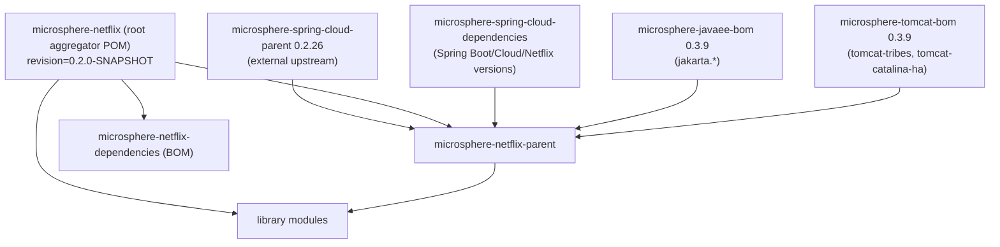

# 父 POM 与依赖 BOM —— 开发者指南

涉及模块：`microsphere-netflix-parent`、`microsphere-netflix-dependencies`

## 构建架构

## 设计决策

### 对 CI 友好的 `${revision}` 版本方案

每个 POM 都声明 `<version>${revision}</version>`，由根 POM 定义 `revision` 属性。flatten-maven-plugin
（在上游 `microsphere-spring-cloud-parent` 中完成配置）会在 install/deploy 阶段解析该占位符，
因此使用方看到的是一个确定的版本号。若要提升整个仓库的版本，只需修改这一个属性。

### 分层依赖管理

父 POM 按顺序导入三个 BOM，因此 Microsphere Netflix 的各模块从不硬编码第三方版本：

| 导入项 | 提供的内容 |
|--------|----------|
| `microsphere-spring-cloud-dependencies` `0.2.26` | Spring Boot、Spring Cloud、Spring Cloud Netflix、`microsphere-spring-*`、`microsphere-java-*` |
| `microsphere-javaee-bom` `0.3.9` | `jakarta.servlet-api` 及 Java EE API 版本 |
| `microsphere-tomcat-bom` `0.3.9` | `tomcat-catalina`、`tomcat-tribes`、`tomcat-catalina-ha` 版本，与 Spring Boot 3 所使用的内嵌 Tomcat 对齐 |

### 仓库内部 BOM

`microsphere-netflix-dependencies` 只管理四个可发布的库
（`eureka-commons`、`eureka-client`、`eureka-client-spring-cloud`、`eureka-server-spring-cloud`），
版本统一使用 `${revision}`。可执行模块 `eureka-server` 被刻意排除——一旦在 BOM 中登记它，
就等于诱导应用去依赖一个应用级产物。

### 可选的注解处理器

各模块将 `microsphere-annotation-processor`、`spring-boot-configuration-processor` 和
`spring-boot-autoconfigure-processor` 声明为 `<optional>true</optional>`：它们在编译期生成配置元数据与
`AutoConfiguration` 排序提示，但绝不能泄漏给使用方。

## 扩展构建

新增一个模块时：

1. 在根 POM 的 `<modules>` 中注册它；如果该模块可发布，还要在
   `microsphere-netflix-dependencies` 中登记。
2. 继承 `microsphere-netflix-parent`，并声明 `<relativePath>../microsphere-netflix-parent/pom.xml</relativePath>`。
3. 依赖第三方库时**不写版本号**——版本全部来自导入的 BOM。

## English

[docs/current/developer-guide/parent-and-dependencies.md](../../../current/developer-guide/parent-and-dependencies.md)
